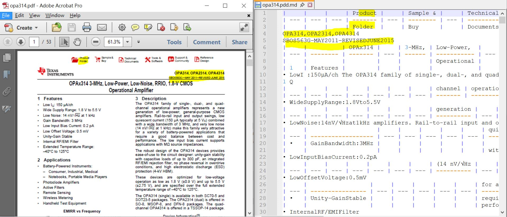

# markitdown_dosbox_installation
markitdown, microsoft open source python tool, uses my dosbox for installation and testing

### recipe
https://github.com/microsoft/markitdown  
https://www.ti.com/lit/ds/symlink/opa314.pdf  

### works to do,
open dosbox under win10/win11  
```
python -m venv .venv
.venv\Scripts\activate.bat
### 如何驗證： 成功後，命令提示字元的最前方會出現 (.venv) 字樣。  

git clone https://github.com/microsoft/markitdown.git
cd markitdown
python -m pip install -e "packages/markitdown[all]"
markitdown opa314.pdf -o opa314.pdf.md
```


### result


